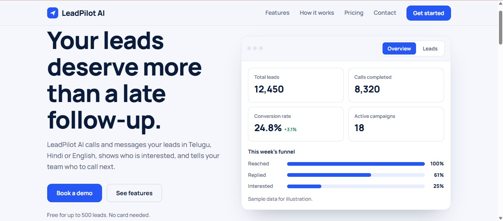
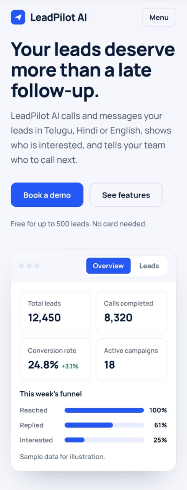

# LeadPilot AI

A responsive SaaS landing page for **LeadPilot AI**, an invented tool that helps businesses follow up with every lead through WhatsApp messages and AI voice calls in Telugu, Hindi and English.

Built as the Front-End Development Internship assignment for Sankar Group.

**Live demo:** https://mahak5123.github.io/Leadpilot-Ai/


## Screenshots

| Desktop | Mobile |
|---|---|
|  |  |


## What's on the page

- **Navigation bar** with logo, section links, a Get started button and a mobile menu.
- **Hero** with a headline, call-to-action buttons and a working dashboard preview.
- **Features** shown as four icon cards.
- **How it works** in three steps.
- **Pricing** with two plans and a monthly/yearly toggle.
- **Demo request form** with validation and a success message.
- **Footer** with links and a note that this is a sample project.

## Interactions

- Nav links and buttons scroll smoothly to their sections.
- The mobile menu opens, closes, and closes again after a link is chosen.
- The dashboard has two tabs: **Overview** (metrics and funnel) and **Leads** (a table where clicking a status cycles New, Contacted and Interested and updates the count).
- The pricing toggle switches the Growth plan between ₹1,499 and ₹1,199 per month.
- The form checks name, email format and company, shows an error under each field that needs fixing, and shows a success message when valid.
- The current section is highlighted in the navigation as you scroll.

## Technologies

- HTML5
- CSS3 (CSS variables, Grid, Flexbox, media queries)
- Vanilla JavaScript (no frameworks or libraries)
- Google Fonts (Manrope)

No backend, database, login or API keys are used.

## Run locally

No installation is needed.

1. Download or clone the repository.
2. Open `index.html` in any modern browser.

To use a local server instead, run `npx serve` in the project folder, or use the Live Server extension in VS Code.

## Project structure

```
Leadpilot-Ai/
├── index.html      # Page structure, styles and scripts
├── screenshots/    # Desktop and mobile screenshots
```

## Design choices

- **Light theme with one blue accent** keeps the page clean and makes the buttons easy to spot. Colours, fonts and spacing are CSS variables so the style stays consistent. The page also follows the device's dark mode.
- **A working dashboard instead of a stock illustration** shows the product in the first screen and demonstrates real interactivity.
- **Indian context**: prices in ₹, Indian names in the sample data, and Telugu and Hindi calling, to fit the product's target market.
- **Mobile first fixes**: the menu collapses, sections stack into one column, and the leads table scrolls sideways on small screens.
- **Accessibility**: visible focus outlines, labelled form fields, keyboard-friendly tabs, and reduced-motion support.

## Challenges solved

- Keeping the dashboard table usable on narrow screens by scrolling it inside its own container rather than letting the whole page scroll sideways.
- Validating the form without a backend, with error messages next to each field and focus moved to the first error.
- Keeping the sticky header from covering section titles after a link is clicked, using scroll padding.

## Note

LeadPilot AI is a fictional product. The numbers, prices and contact details on the page are sample content for this assignment.
